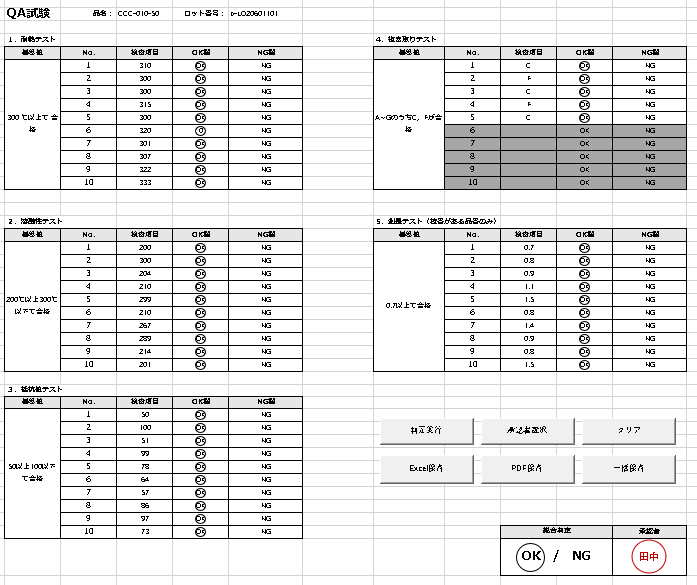

# QA試験 — 検査表自動化ツール(最終形態)

> 本ツールは検査表自動化シリーズの完成版です。要件の異なる派生版([検査表2](https://github.com/kondo-works-lab/Inspection-sheets-checker2)、[検査表3](https://github.com/kondo-works-lab/Inspection-sheets-checker3))
で得た知見を踏まえ、汎用性・使いやすさを高めた形にまとめています。

Excel VBAで作成した検査表業務の自動化ツールです。
## 機能

- **入力チェック**: 検査表の入力内容をチェック
- **電子印鑑**: 電子印鑑の作成・押印
- **Excel保存**: 検査表をExcel形式で保存
- **PDF保存**: 検査表をPDF形式で保存(保存先フォルダを選択可能)
- **保存履歴**: 保存した検査表の履歴を管理

## シート構成

- `検査表`: 検査項目の入力・チェックを行うメインシート
- `検査項目一覧`: 検査項目のマスタデータ
- `電子印鑑`: 電子印鑑の作成・管理
- `保存履歴`: 保存履歴の記録

## 使用technology

- Excel VBA

## 使い方

1. `QA試験.xlsm` を開く(マクロを有効にする)
2. `検査表` シートで検査項目を入力
3. 承認者選択で電子印鑑を押印
4. Excel/PDF形式で保存

## スクリーンショット

### 検査表画面


### 電子印鑑


---

## QA試験v2（表紙＋明細シート方式の新しい検査表）

品名ごと・検査ごとの項目と基準をマスタで管理し、検査ごとの明細シートで判定する新しい検査表です。
既存の `QA試験.xlsm` はそのまま残しています（電子印鑑・保存の機能を流用しています）。

### フォルダ構成

```
QA試験v2/
  src/
    modCommon.bas    共通の定数・関数
    modMaster.bas    マスタの読み込み・チェック
    modDetail.bas    明細シートの作成・判定
    modCover.bas     表紙（検査一覧・総合判定）、品名変更・入力変更の処理
    modStamp.bas     電子印鑑（生成・削除・押印）
    modSave.bas      Excel／PDF保存（保存先フォルダを選択）
    modAccess.bas    Accessへの登録
    modSetup.bas     セットアップ（シート・ボタン・サンプルマスタの作成）
    modTest.bas      自動テスト
    ThisWorkbook.cls ThisWorkbook に貼り付けるコード
```

ソースは VBE からそのまま取り込めるよう Shift-JIS（CRLF）で保存しています。

### 導入手順（初回のみ）

1. Excel で新しいブックを作り、「Excel マクロ有効ブック（*.xlsm）」で保存する（例：`QA試験v2.xlsm`）。
2. `Alt + F11` で VBE を開き、「ファイル」→「ファイルのインポート」で `src` フォルダの `mod*.bas`（9ファイル）をすべて取り込む。
3. VBE の「ThisWorkbook」をダブルクリックし、`ThisWorkbook.cls` の内容をメモ帳で開いてすべて貼り付ける。
4. 既存の `QA試験.xlsm` も開き、VBE のプロジェクトエクスプローラーで `QA試験.xlsm` の `frmApprover`（承認者選択フォーム）を新しいブックへドラッグしてコピーする。
5. 「開発」→「マクロ」から `セットアップ` を実行する。表紙・マスタ・電子印鑑・設定シートとボタンが作られ、架空のサンプルマスタ（SMP-A100、SMP-B200）が入る。
6. 電子印鑑シートで担当者名（B3:B10）を確認し、「電子印鑑生成」を押す。
7. ブックを上書き保存する。

参照設定の追加は不要です（Access 連携は実行時に ADO を呼び出します）。

### 使い方

1. 表紙の **品名** を入力する。マスタにあるその品名の検査分だけ明細シート（`明細_検査名`）が作られ、表紙に検査一覧（判定結果・担当者印欄）と総合判定欄が並ぶ。
   - 品名を変えると明細シートを作り直す。入力データ・判定結果・印鑑は消去される（既存ツールと同じく、メッセージで再判定・再押印を促す）。
   - マスタに無い品名や、マスタに誤りがある場合はメッセージを表示し、明細シートは作らない。
2. ロット・状態・日付を入力する（状態は自由入力）。
3. 各明細シートの白い欄に検査値を入力し、「判定」を押す。
   1. 未入力・グレーの欄への入力・数値以外の入力があれば、メッセージを出して判定しない。
   2. 基準外のセルの背景がオレンジになる。
   3. オレンジの個数が不合格個数以上なら「不合格」、未満なら「合格」。
   4. 表紙の該当検査の判定結果と総合判定が更新される（1つでも不合格なら「不合格」、全検査が合格なら「合格」、未判定の検査があれば空欄）。
   5. 判定データが Access に登録される。
   - 判定の後に入力値を変えると、その検査の判定結果・担当者印と、表紙の承認者印・担当者印が消える。もう一度「判定」と押印を行う。
4. 押印する。
   - 各検査の担当者印：表紙の検査一覧の「押印」ボタン（その検査の判定後に押せる）
   - 承認者・担当者：表紙の「承認者 押印」「担当者 押印」ボタン（全検査の判定後に押せる）
5. 保存する。「Excel保存」「PDF保存」「一括保存」を押すと保存先フォルダを選ぶ画面が出る。
   - 保存するのは表紙と明細シート（ボタンは除く）。ファイル名は `品名_ロット_日付(yyyymmdd)`。
   - 未判定の検査や印鑑の不足があれば、保存してよいか確認する。
   - 保存した記録は「保存履歴」シートに残る。

### マスタの書き方

マスタシートの 4 行目以降に、**1行に1項目** を書きます。行を足すだけで品名・検査・項目を追加できます。

| 列 | 項目 | 書き方 |
|---|---|---|
| B | 品名 | 表紙に入力する品名（大文字・小文字は区別しない） |
| C | 検査名 | 明細シート名になる（`明細_検査名`）。`\ / : * ? [ ]` は使えない。28文字まで |
| D | 項目名 | 明細シートに表示する検査項目 |
| E | 判定方式 | `一致` / `以上` / `以下` / `範囲` のどれか |
| F | 基準値1 | 一致：合格の文字（`A,B` のようにカンマ区切りで複数可）／以上：下限／以下：上限／範囲：下限 |
| G | 基準値2 | 範囲：上限（それ以外は空欄） |
| H | n数 | その項目の入力欄の数（1～30）。n数を超える欄はグレーになる |
| I | 不合格個数 | 基準外（オレンジ）がこの個数以上で不合格。検査ごとの値なので、その検査のどれか1行に書けばよい（複数行に書く場合は同じ値に） |
| J | 備考 | 自由に使える（判定には使わない） |

- 検査の並び順・項目の並び順は、マスタに書いた行の順です。
- 境界値ちょうどは合格です（例：`0.9 以上` に 0.9 は合格、`10～20` に 10・20 は合格）。
- `一致` は前後の空白を除き、全角／半角・大文字／小文字を区別せずに比べます。

記入例：

| 品名 | 検査名 | 項目名 | 判定方式 | 基準値1 | 基準値2 | n数 | 不合格個数 |
|---|---|---|---|---|---|---|---|
| SMP-A100 | 外観検査 | 外観ランク | 一致 | A,B | | 5 | 2 |
| SMP-A100 | 外観検査 | 色調 | 一致 | 良 | | 3 | |
| SMP-A100 | 寸法検査 | 長さ(mm) | 範囲 | 9.5 | 10.5 | 5 | 1 |
| SMP-A100 | 寸法検査 | 厚み(mm) | 以下 | 2.0 | | 5 | |
| SMP-A100 | 強度検査 | 引張強度(kN) | 以上 | 0.9 | | 3 | 1 |

マスタを変更したときは、表紙の品名を入れ直すと明細シートに反映されます。

### Access 連携

- **DBファイル**：設定シートの C3 に書いたパス。空欄ならこのブックと同じフォルダの `QA試験DB.accdb`。
  ファイルやテーブルが無ければ最初の判定時に自動で作成します（Access 本体は不要。Office に付属する ACE OLEDB プロバイダを使います）。
- **登録のタイミング**：明細シートの「判定」を押したとき（押下時刻は VBA の `Now` を渡します）。再判定は上書きせず追記します。
- 登録に失敗しても判定結果はシートに残り、メッセージだけ表示します。

`T_判定`（判定1回＝検査1つにつき1行）

| 列 | 型 | 内容 |
|---|---|---|
| 判定ID | オートナンバー | 主キー |
| 押下日時 | 日付/時刻 | 「判定」ボタンを押した時刻 |
| 品名・ロット・状態 | 短いテキスト | 表紙の値 |
| 日付 | 日付/時刻 | 表紙の日付（日付でなければ空） |
| 検査名・判定結果 | 短いテキスト | 合格／不合格 |
| 基準外個数・不合格個数 | 数値 | オレンジの個数と、マスタの不合格個数 |
| 総合判定 | 短いテキスト | 登録時点の総合判定（未確定なら空） |
| ブック名 | 短いテキスト | 判定したブックのファイル名 |

`T_判定明細`（入力値1つにつき1行。`判定ID` で `T_判定` とつながる）

| 列 | 型 | 内容 |
|---|---|---|
| 明細ID | オートナンバー | 主キー |
| 判定ID | 数値 | `T_判定` の判定ID |
| 項目No・項目名・判定方式・基準 | 数値／短いテキスト | 明細シートの値 |
| サンプルNo | 数値 | 入力欄の番号（1～n） |
| 入力値 | 短いテキスト | 入力された値 |
| 合否 | 短いテキスト | 合格／基準外 |

### 自動テスト

マクロ `テスト実行` を実行すると、テスト用の架空品名（ZZTEST-…）をマスタに一時的に追加して、
判定方式ごとの合否・オレンジ表示・表紙への反映・総合判定・品名変更・押印・保存（Excel/PDF）・Access 登録を確認し、
結果を「テスト結果」シートに書き出します。テスト用の DB と保存ファイルは一時フォルダ（`%TEMP%`）に作られ、パスが結果シートに表示されます。
終了後、テスト用のマスタ行は削除され、表紙の品名・ロット・状態・日付は元に戻ります（明細シートは作り直されるため、入力中のデータは消えます）。
押印のテストは、電子印鑑シートに「田中」の印影があるときだけ実行されます。
